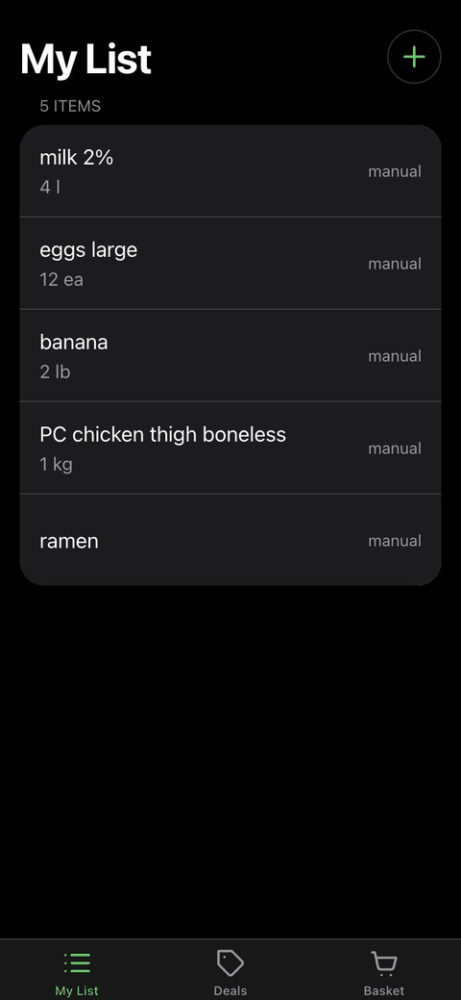

<p align="center">
  
</p>

<p align="center">
  
</p>

<p align="center">
  
</p>

# Real Deal

Weekly grocery flyers from five Vancouver chains, matched to what a UBC student actually buys (learned from their
receipts), with the cheapest store for the whole basket. Mobile-first PWA, HackCamp 2026, Databricks track.

- Spec: [`docs/superpowers/specs/Real Deal — MVP Design.md`](docs/superpowers/specs/Real%20Deal%20—%20MVP%20Design.md)
- Plan, workstreams, go/no-go, cut list: [`docs/plan.md`](docs/plan.md)

## Setup (every teammate)

Prereqs: [uv](https://docs.astral.sh/uv/) (installs Python 3.12 for you), Node 20+, make (macOS/Linux; Windows uses dev.cmd), git.
WS1 and the demo laptop also need the [Databricks CLI](https://docs.databricks.com/dev-tools/cli/install.html).

```sh
git clone https://github.com/krish-arora-88/SurRealDeal.git && cd SurRealDeal
make setup   # uv sync + npm ci + copies .env.example to .env
make dev     # API on :8000, PWA on :3000; Ctrl-C stops both
```

On Windows, use the command file instead of `make setup` and `make dev`:

```powershell
.\dev.cmd setup  # install dependencies and create .env if it doesn't exist
.\dev.cmd dev    # start both servers; Ctrl-C stops them
```

`dev.cmd dev` refuses to start until setup has installed apps/web/node_modules and created .env.

Open http://localhost:3000. With an empty `.env` everything runs on **mock data**: a new device gets five seeded
list items, mock flyers for five stores, canned receipt and voice extraction. API docs: http://localhost:8000/docs.

On your phone: run `make tunnel` in a second terminal (`brew install cloudflared` once) and open the
`https://….trycloudflare.com` URL it prints. Campus Wi-Fi (eduroam) blocks phone-to-laptop traffic, and the camera,
mic and home-screen install need HTTPS anyway. The URL changes each run.

Other targets: `make test` (pytest), `make lint` (ruff + eslint + tsc), `make gen-api` (regenerate the typed web
client after changing the API; CI fails if you forget), `make flipp-snapshot` (refresh mock data with this
week's real flyer prices — see "Flyer data: Flipp integration" below).

## Environment variables

| Variable | Used by | Blank means |
| --- | --- | --- |
| `DATABRICKS_HOST` | API, fetchers, setup scripts | API runs in mock mode |
| `DATABRICKS_TOKEN` | same | |
| `DATABRICKS_WAREHOUSE_ID` | API (SQL Statement API) | |
| `ANTHROPIC_API_KEY` | API extractor (receipts, photos, manual text) | mock extractor |
| `ELEVENLABS_API_KEY` | API voice proxy | canned transcript |

Overrides: `REALDEAL_MOCK=0|1`, `EXTRACTOR=mock|claude|databricks`, `ANTHROPIC_MODEL`, `API_URL` (web → API proxy target).
Never commit `.env`.

The web app reads its own settings from `apps/web/.env.local` (git-ignored). `DATABRICKS_APP_URL` there switches
its `/api/*` proxy from the local API to the Databricks App; see below.

## Host the API on Databricks (demo)

For the demo the API runs as a Databricks App and the PWA stays on the demo laptop (with `make tunnel` for the
phone). Databricks Apps only accept signed-in callers, so the laptop's Next.js server adds an OAuth token from the
Databricks CLI to every `/api/*` request ([`route.ts`](apps/web/src/app/api/[...path]/route.ts)); the browser never
sees it. Personal access tokens can't be exchanged for app tokens, which is why this uses the CLI login.

Because every proxied call carries that token, **the proxy only serves devices that entered the demo passcode**
(`DEMO_PASSCODE`, at `/unlock`), and refuses everyone while it's unset. Anyone with the tunnel URL can still load the
PWA's pages, but its data calls fail until that device is unlocked. The proxy also replaces any client-sent
`X-Forwarded-For`/`X-Real-IP`/`Forwarded`/`CF-Connecting-IP` with the real visitor IP (Cloudflare's
`CF-Connecting-IP` through the tunnel), so the API's per-visitor upload limit can't be dodged.

**1. Create the app (workspace admin, once).** Run these where the [Databricks CLI](https://docs.databricks.com/dev-tools/cli/install.html)
is logged in to the team workspace.

1. Store the API keys as secrets (each command prompts for the value):
   ```sh
   databricks secrets create-scope realdeal
   databricks secrets put-secret realdeal anthropic-api-key
   databricks secrets put-secret realdeal elevenlabs-api-key
   ```
2. In the workspace: **Compute → Apps → Create app → Custom**, name it `realdeal-api`, and add three resources with
   exactly these keys ([`app.yaml`](app.yaml) reads them):

   | Resource key | Type | Points at | Permission |
   | --- | --- | --- | --- |
   | `sql-warehouse` | SQL warehouse | the team warehouse | Can use |
   | `anthropic-api-key` | Secret | scope `realdeal`, key `anthropic-api-key` | Can read |
   | `elevenlabs-api-key` | Secret | scope `realdeal`, key `elevenlabs-api-key` | Can read |
3. Give the app's service principal access to the data. Its application ID is on the app's **Authorization** tab:
   ```sql
   GRANT USE CATALOG ON CATALOG realdeal TO `<app-service-principal-application-id>`;
   GRANT USE SCHEMA, SELECT, MODIFY ON SCHEMA realdeal.core TO `<app-service-principal-application-id>`;
   GRANT READ VOLUME ON VOLUME realdeal.core.flyers TO `<app-service-principal-application-id>`;
   GRANT READ VOLUME, WRITE VOLUME ON VOLUME realdeal.core.uploads TO `<app-service-principal-application-id>`;
   ```
4. Give whoever logs in on the demo laptop **Can use** on the app (app page → **Permissions**).

**2. Deploy (first time, and after every API change).** From the repo root:

```sh
# Only when Python dependencies changed: the app installs from requirements.txt, not uv.lock.
uv export --no-dev --no-hashes --no-emit-project --format requirements-txt -o requirements.txt
databricks sync --full . /Workspace/Users/<you>/realdeal-api      # respects .gitignore: no .env, no node_modules
databricks apps deploy realdeal-api --source-code-path /Workspace/Users/<you>/realdeal-api
```

Check it: open the app URL in a browser where you're signed in to Databricks and add `/health`. It should show
`"mock": false` and `"extractor": "ClaudeExtractor"`; `/docs` shows the API.

**3. Point the demo laptop at it.**

1. Install the Databricks CLI, then sign in once (a browser opens; the CLI keeps the login refreshed):
   ```sh
   databricks auth login --host https://<workspace>.cloud.databricks.com
   ```
2. Create `apps/web/.env.local` (git-ignored). Pick a passcode of at least 8 characters, e.g. four random words,
   and share it only with whoever runs the demo:
   ```
   DATABRICKS_APP_URL=https://<app URL from the app page>
   DATABRICKS_HOST=https://<workspace>.cloud.databricks.com
   DEMO_PASSCODE=<at least 8 characters>
   ```
3. Start the PWA as usual (`make dev` or `.\dev.cmd dev`; the local API it also starts is simply unused) and
   `make tunnel` for the phone. Delete `apps/web/.env.local` to go back to the local API.
4. On each demo device (the phone, and the laptop browser if you use it), open `/unlock` once and enter the
   passcode. It sets an HttpOnly cookie for 7 days; ten wrong guesses from one IP lock it out for 15 minutes.

**Known limitations (accepted for the demo):** there's no login, so `X-User-Id` is a device-generated ID the API
trusts as-is; anyone who has unlocked the demo and knows another device's ID could read that list. Without the
tunnel, a client on the same network can still spoof its forwarded IP, because Next.js keeps a client-sent
`X-Forwarded-For`; the passcode limits who can reach the proxy, and the API's global upload cap still applies.

**Before judging:** Free Edition stops apps after 24 hours, so restart it Sunday morning
(`databricks apps start realdeal-api`), then load the Deals tab once so the SQL warehouse is warm. If the PWA shows
"Couldn't get a Databricks token", run the `databricks auth login` command again.

## Flyer data: Flipp integration

Real flyer data comes from [Flipp](https://flipp.com)'s public, unauthenticated flyer API
(`https://backflipp.wishabi.com/flipp`) via `shared/flipp.py` — unofficial, so the client is throttled
(0.5 s between calls), retries once, times out at 20 s, and sends a descriptive User-Agent. Endpoints used:

| Endpoint | Gives us |
| --- | --- |
| `GET /flyers?locale=en-ca&postal_code=<postal>` | This week's flyers for a postal code; filtered to the merchant + a `categories_csv` containing "Groceries" (a merchant can run non-grocery flyers too, e.g. Superstore's Toy Book) |
| `GET /flyers/{id}?locale=en-ca` | A flyer's item list + pages. `pages[]` carries no image URL (confirmed live on five flyers) |
| `GET /items/{item_id}` | Full item detail: `description` (sometimes a size, often not), `current_price`, `image_url` (the full flyer page this item sits on) |
| `GET /items/{item_id}` | Full item detail: `description` (sometimes a size, often not), `current_price`, `image_url` (a product photo, not the page) |

`to_extracted_item()` parses an item (+ detail) into the same `ExtractedItem` shape every other extraction
mode returns, reading size from `description` first and falling back to parsing it out of the product name;
rows with no price anywhere are skipped. `fetch_grocery_flyer()` only spends the extra `/items/{id}` call when
the list data alone didn't already give a price and a parseable size.

**Fetcher** (`databricks/fetchers/flipp.py`, all five stores) writes `flyers/<store>/<week_start>/flipp.jsonl`
to the Volume with each item's exact tile box, page, price and valid dates; the pipeline turns it into
`flyer_items` (see `docs/plan.md`, WS1 step 6). Page images saved by hand still go through
`databricks/fetchers/common.py <store> <dir>`.

**Mock mode with real prices**: `make flipp-snapshot` (`apps/api/snapshot_flipp.py`) saves all five stores'
current flyers to `apps/api/data/flipp_snapshot.json`. `apps/api/mock_data.py` loads it if present, falling
back to the small canned list otherwise — the API never touches the network for this at request time; refresh
the snapshot by hand whenever you want fresher demo prices.


## Claim a workstream

Four workstreams (Data/Pipeline, Backend, Frontend, Design & Pitch) are in [`docs/plan.md`](docs/plan.md), each with
ordered tasks, the interface it must not break, and its done-when. Put your GitHub handle on its `Owner:` line, branch
as `ws<N>/<topic>`, and open small PRs to `main`. CI (pytest, ruff, eslint, tsc, build, OpenAPI drift) must pass.

## Workstream 3: Frontend — status

Done, on [`ws3/polish`](https://github.com/krish-arora-88/SurRealDeal/pull/3) (owner: [@TahaSaiyed08](https://github.com/TahaSaiyed08)):

- Intake bottom sheet from My List: receipt photo, product photo, manual text, hold-to-talk voice
  (`src/components/list/{AddMethodsSheet,ReceiptConfirmSheet,PickProductSheet,TypeOrSaySheet}.tsx`)
- Confirm screens flag low-confidence rows (`confidence < 0.6`) for edit before `POST /items`; product photo
  shows a chip picker over the extractor's candidates
- Deals (exact matches only: brand, item, variant and size) and Basket (cheapest store, split-shop, dollar delta,
  "no deal this week") tabs
- Client-side image downscale (≤2000px, JPEG q0.8) before every upload; avoids the API's 413 and normalizes
  iPhone HEIC
- Error handling throughout: status-mapped upload errors (413/415/429 with `Retry-After`), a save-retry banner
  instead of losing confirmed items on failure, optimistic delete with rollback, `AbortController` + 30s
  timeout per intake call, revoked object URLs
- Voice: aria-labelled hold-to-talk, empty-recording and unsupported-browser messages, a released-before-start
  guard and stream cleanup on `MediaRecorder` failure
- `/dev/states` (the reviewer-only screen gallery) is gated out of production builds
- One Playwright smoke test (`apps/web/e2e/smoke.spec.ts`): opens the PWA, adds an item manually, confirms the
  match in Deals — wired into CI alongside `pytest`/`ruff`/`eslint`/`tsc`/`next build`/`make check-api`

## Layout

```
apps/api/        FastAPI: routes (main.py), models mirroring the tables, extractors, SQL client, STT proxy
apps/web/        Next.js 15 PWA: 3 tabs, HIG tokens (src/app/globals.css), typed client (src/lib/)
shared/          normalize_unit + tests, versioned prompts (flyer_page, receipt, product, manual)
databricks/      sql/ (DDL), pipeline/ (Lakeflow Bronze→Silver→Gold), fetchers/ (Flipp, all 5 stores), setup/
databricks.yml   Asset bundle for the pipeline
app.yaml         Databricks App that hosts the API for the demo (requirements.txt is its package list)
.mcp.json        Databricks docs MCP (devhub-docs) for Claude Code
```

## Claude Code

`.mcp.json` registers the Databricks developer docs MCP server (`devhub-docs`). Claude Code asks you to approve it
the first time you open the repo; then ask it things like "how do I trigger a Lakeflow pipeline update".
