<p align="center">
  
</p>

<p align="center">
  <b>Every grocery flyer near you, matched to what you actually buy, with the cheapest store for the whole basket.</b><br />
  A mobile-first PWA built at HackCamp 2026 on <b>Databricks</b>, with <b>Gemini</b> and <b>ElevenLabs</b> in the intake, a <b>Figma</b>-first design, and <b>Freebuff</b> in our toolbox.
</p>

<p align="center">
  <a href="#see-it">See it</a> ·
  <a href="#how-it-works">How it works</a> ·
  <a href="#prizes-were-going-for">Prizes</a> ·
  <a href="#built-with-our-sponsors">Sponsors</a> ·
  <a href="#architecture">Architecture</a> ·
  <a href="#setup-every-teammate">Run it</a> ·
  <a href="#devpost">Devpost</a>
</p>

<p align="center"></p>

## See it

<p align="center">
  
</p>

Real screenshots of the app running against this week's real flyers near V6T 1Z4 (UBC):

<table align="center">
  <tr>
    <td align="center">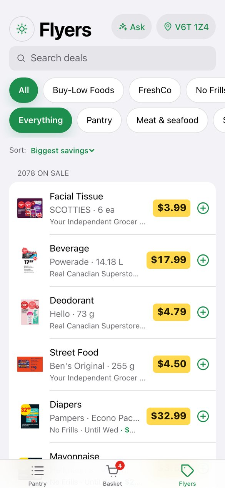<br /><sub><b>Flyers</b><br />every deal near you</sub></td>
    <td align="center">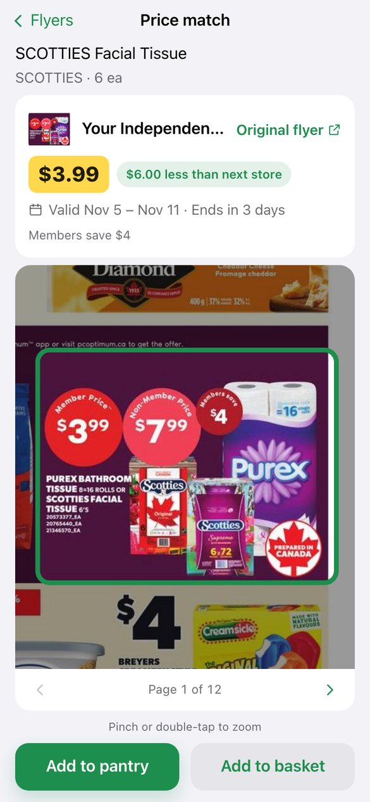<br /><sub><b>Price Match</b><br />the real flyer page</sub></td>
    <td align="center">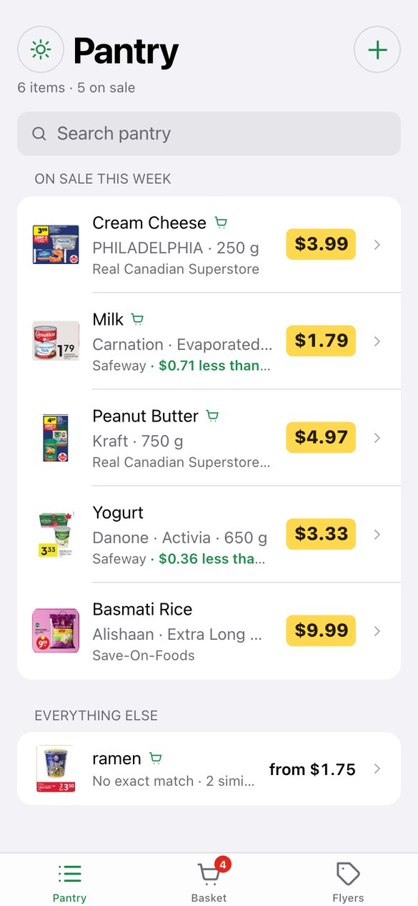<br /><sub><b>Pantry</b><br />what you buy, on sale</sub></td>
  </tr>
  <tr>
    <td align="center">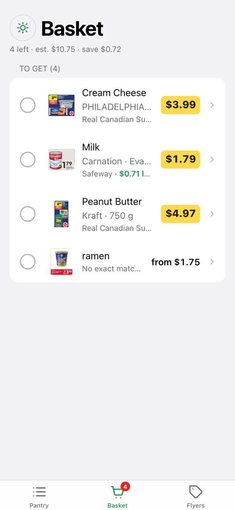<br /><sub><b>Basket</b><br />a checklist for the trip</sub></td>
    <td align="center">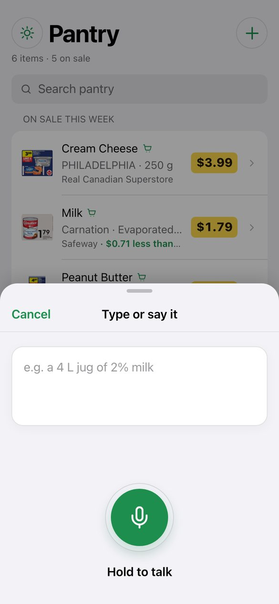<br /><sub><b>Say it</b><br />hold to talk</sub></td>
    <td align="center">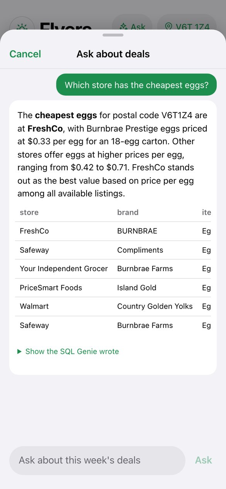<br /><sub><b>Ask</b><br />Genie, in plain words</sub></td>
  </tr>
</table>

<p align="center"></p>

## How it works

1. **Flyers.** The API pulls this week's real flyers for your postal code from [Flipp](https://flipp.com): up to ten grocery chains, anywhere in Canada. It keeps them fresh by itself (it checks hourly and re-downloads only the stores whose flyer changed).
2. **Your items.** Add what you buy by scanning a receipt, photographing a product, typing it, saying it, or tapping **+** on any flyer item. Each is read into brand, item, variant and size.
3. **Exact matches only.** A listing matches only if brand, item, variant and size all agree (a 4 L jug is not a 2 L one). Sizes are compared in base units, so `2 x 1.89 L` and `4 L` are the same.
4. **The cheapest store.** Each item shows its cheapest store and how much it saves over the next. Tap it to open the real printed flyer page with the item outlined, and a link to the store's own page for the product.
5. **The Basket** is a checklist for the trip, and **Ask** answers questions about the week's deals in plain words.

| Tab | What it is |
| --- | --- |
| **Pantry** | Everything you've added, split into "on sale this week" and "everything else", with the cheapest store for each. |
| **Basket** | The items you're buying this trip: tick them off (they move to Done, and stay in Pantry), undo, clear done. |
| **Flyers** | Every priced listing near you, one row per product at its cheapest store. Search, filter by store and category, sort, and tap **+** to add. |

<p align="center"></p>

## Prizes we're going for

| Prize | Why it fits | Where to look |
| --- | --- | --- |
| **Best Use of Databricks** | Unity Catalog tables, a Lakeflow pipeline, the SQL Statement API, Genie, Model Serving, `ai_query`, Volumes and a Databricks App, all doing real work in the app. | [Databricks](#databricks-the-lakehouse-under-the-whole-app) |
| **Best Design** | Designed in Figma first (18 screens), built to match, with light and dark themes, large tap targets and screen-reader support. | [Figma and design](#figma-designed-first-then-built) |
| **Best Use of Gemini API** | Gemini reads receipts, product photos and typed lines into items, as a drop-in extractor beside Claude and `ai_query`. | [Gemini](#gemini-a-second-pair-of-eyes-for-receipts) |
| **Community Impact** | Students on a food budget compare 30 to 40 pages of flyers by hand every week; Savy does it for them, free and with no account. | [Community impact](#community-impact) |
| **Best Project Built with Freebuff** | Freebuff is one of the coding agents we built it with. | [Freebuff](#freebuff-our-coding-agent) |

The Overall Winner and nwChoice awards need no opt-in.

<p align="center"></p>

## Built with our sponsors

### Databricks: the lakehouse under the whole app

<p align="center">
  
</p>

| Brick | What it does | Where |
| --- | --- | --- |
| **Unity Catalog tables** | `live_listings` (this week, replaced per postal code) and `price_history` (every listing ever seen, merged weekly, so prices can be tracked). | [`databricks_sync.py`](apps/api/databricks_sync.py) |
| **Lakeflow pipeline** | Bronze → Silver → Gold: flyer pages and Flipp data become `flyer_items` and weekly prices. | [`databricks/pipeline/`](databricks/pipeline) |
| **SQL Statement API** | Every read and write in Databricks mode. Fixed statements with named parameters, a 5 s budget and a last-good cache, so a slow warehouse never freezes the app. | [`databricks_sql.py`](apps/api/databricks_sql.py), [`store.py`](apps/api/store.py) |
| **Genie** | A space over the two tables, with instructions and worked examples. The Flyers tab's **Ask** button sends your question and shows the answer, the table and the SQL Genie wrote. | [`genie_space.py`](databricks/setup/genie_space.py), [`genie.py`](apps/api/genie.py) |
| **Model Serving** | An AI refiner (Llama 4 Maverick) turns messy flyer text into brand, item, variant and **category**, cached per name so a product is only ever asked about once. | [`refine.py`](apps/api/refine.py) |
| **`ai_query`** | An opt-in extractor for receipts and photos (`EXTRACTOR=databricks`). Slower than Claude on the demo receipt, so Claude stays the default. | [`extractors.py`](apps/api/extractors.py) |
| **Volumes** | Receipt photos and flyer page images. | [`store.py`](apps/api/store.py) |
| **Databricks App** | Hosts the API for the demo. | [`app.yaml`](app.yaml) |

Nothing is written to your workspace unless you run `make databricks-setup` and set `REALDEAL_DATABRICKS_SYNC=1`.

<p align="center"></p>

### Gemini: a second pair of eyes for receipts

<p align="center">
  
</p>

Adding what you buy starts with reading it, from a receipt photo, a product photo, or a line you typed. Gemini is a full extractor for all three, behind the same interface as Claude and `ai_query`, so switching is one setting: `EXTRACTOR=gemini` (or just set `GEMINI_API_KEY` and no Anthropic key).

- **Structured by design.** Gemini is asked for JSON that matches our `Extraction` schema and the reply is validated against it, so a malformed answer becomes a clean "couldn't read that" instead of bad data in your list ([`GeminiExtractor`](apps/api/extractors.py)).
- **Same prompts, same results.** It reuses the versioned receipt, product and typed-text prompts, so the confirm screens (including low-confidence flags) work unchanged.
- **Safe to run.** The key travels in a header, never a URL; one retry on a busy response; every failure maps to the same 502 or 422 the other extractors use; and the file type is sniffed from the bytes, not trusted.
- **Tested live and offline.** A receipt photo parsed to its store, total and 14 line items in about 17 seconds, and typed text and a product photo came back in a few seconds through the real `/intake` endpoints. 11 offline tests cover the request, retries, errors and selection ([`test_gemini.py`](apps/api/test_gemini.py)).
- **Model:** `gemini-3.5-flash` by default; set `GEMINI_MODEL` to change it.

<p align="center"></p>

### ElevenLabs: hold the button, say it

<p align="center">
  
</p>

Hold-to-talk in the **Add** sheet records in the browser, uploads to `POST /intake/voice`, and our API sends it to **ElevenLabs Scribe** (`scribe_v1`) for the transcript. The text goes through the same extractor as typing, and you confirm before anything is saved.

- **The key stays on the server.** The browser never sees `ELEVENLABS_API_KEY` ([`stt.py`](apps/api/stt.py)).
- **Silence is caught** before an extraction is paid for, with a clear "Didn't catch that" instead of an invented item.
- **Failures are friendly:** a speech-service outage tells you to type instead (a 502, not a crash), and uploads are rate-limited per client.
- **No key? It still works.** A canned transcript stands in, so a fresh clone can demo voice with no account.
- **UI:** hold-to-talk with an accessible label, empty-recording and unsupported-browser messages, and stream cleanup ([`TypeOrSaySheet.tsx`](apps/web/src/components/list/TypeOrSaySheet.tsx)).

<p align="center"></p>

### Figma: designed first, then built

<p align="center">
  
</p>

The app started as a Figma file: mobile frames for every tab, sheet and state, in light and dark, with a rationale per iOS HIG element. We then built **all 18 screens** into the PWA (My List, the receipt flow, Pick a product, Type or say it, Deals and Basket, each with its loading, empty and dark states).

- **One token system.** Colours, type and spacing live as tokens in [`globals.css`](apps/web/src/app/globals.css), so the app reads the same as the frames, and a real light/dark toggle follows them.
- **Every state is reviewable.** A dev-only gallery at `/dev/states` renders each screen and state side by side (it is gated out of production builds).
- **It kept growing in the same language.** The three-tab layout (Pantry, Basket, Flyers), Price Match with real flyer pages, and the Ask sheet came after the original frames and reuse their components ([`ui.tsx`](apps/web/src/components/ui.tsx), `Sheet`, `Chip`, `ItemEditor`).

**For the Best Design prize**, here is what you can check in the app and the code:

- **Designed in Figma first.** 18 mobile screens, then built to match. <!-- Add the Figma link here, and on Devpost: the prize requires it. -->
- **Large, consistent tap targets.** A 44 pt minimum (`--tap`) on the main buttons and rows, from one token system.
- **Light and dark, for real.** It follows the phone's setting and has a toggle that persists across tabs and reloads (there is a test for it).
- **Screen-reader friendly.** Icon buttons have labels, and loading, errors, toasts and the Ask answer are announced through live regions.
- **Calm motion.** The loading shimmer stops when the phone asks for reduced motion.
- **Phone-aware layout.** Safe-area insets keep controls clear of notches and the home bar.
- **Every state is reviewable.** `/dev/states` lays out each screen and state in one place (dev builds only).

<p align="center"></p>

### Freebuff: our coding agent

<p align="center">
  
</p>

We used Freebuff as one of the coding agents we built Savy with at HackCamp, alongside Claude Code. <!-- Judges need specifics: add which parts Freebuff built or reviewed, and what it saved us. -->

<p align="center"></p>

### Devpost

<p align="center">
  
</p>

HackCamp 2026, Databricks track. The Devpost page holds the story, what it is built with and how to try it; the fastest way to try the app yourself is [Run it](#setup-every-teammate) below, which works with no keys at all.
<!-- Add the Devpost project link here when it is published. -->

<p align="center"></p>

## Community impact

**The problem.** Students on a food budget re-make the same decision every week: where to shop, and what is actually cheap. Today that means 30 to 40 pages of flyers across Flipp and store apps, none of which know what you buy or compare unit prices across stores.

**What Savy changes.**

- **It does the comparing.** You see deals only on the items you buy, the cheapest store for each, and for the whole basket, with prices compared per 100 g, per 100 ml or per item, so a bigger pack is judged fairly.
- **It is free and open to anyone.** No account, no sign-up, nothing to install: it runs in a phone browser, for any Canadian postal code, on public flyer data.
- **It meets people where they are.** Add items by saying them (hands-free) or snapping a receipt, and see the real flyer page, not a rewritten summary.
- **It respects privacy.** There is no login; your postal code goes in a header, not a URL; and nothing is stored in the cloud unless you turn that on.

**What we are honest about.** This is a hackathon prototype on an unofficial data source, so prices are only as good as the flyers, and we have not measured how much a shopper saves. The next step would be to test it with students for a few weeks and measure exactly that.

<p align="center"></p>

## Architecture

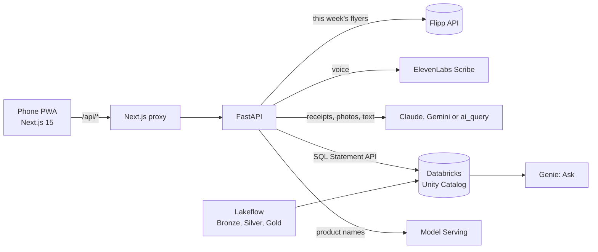

The API runs in one of two modes. **Mock mode** (the default, no Databricks needed) keeps your list in memory and serves live Flipp flyers. **Databricks mode** reads and writes Unity Catalog tables. Either way the web app talks to the same typed client, generated from the API's OpenAPI schema (`make gen-api`).

<p align="center"></p>

## Setup (every teammate)

Prereqs: [uv](https://docs.astral.sh/uv/) (installs Python 3.12 for you), Node 20+, make (macOS/Linux; Windows uses dev.cmd), git.
WS1 and the demo laptop also need the [Databricks CLI](https://docs.databricks.com/dev-tools/cli/install.html).

```sh
git clone https://github.com/krish-arora-88/SurRealDeal.git && cd SurRealDeal
make setup   # uv sync + npm ci + copies .env.example to .env
make dev     # API on :8000, PWA on :3000; Ctrl-C stops both
```

On Windows, use the command file instead of `make setup` and `make dev`:

```powershell
.\dev.cmd setup  # install dependencies and create .env if it doesn't exist
.\dev.cmd dev    # start both servers; Ctrl-C stops them
```

`dev.cmd dev` refuses to start until setup has installed apps/web/node_modules and created .env.

Open http://localhost:3000. With an empty `.env` no keys are needed: the app shows **this week's real flyers** near V6T 1Z4 (the first
download takes about 30 seconds), a new device starts with a few staples from them, and receipt, photo and voice entry use canned
results. Add keys (below) to switch each piece to the real service. API docs: http://localhost:8000/docs.

On your phone: run `make tunnel` in a second terminal (`brew install cloudflared` once) and open the
`https://….trycloudflare.com` URL it prints. Campus Wi-Fi (eduroam) blocks phone-to-laptop traffic, and the camera,
mic and home-screen install need HTTPS anyway. The URL changes each run.

Other targets: `make test` (pytest and vitest), `make lint` (ruff + eslint + tsc), `make gen-api` (regenerate the typed web
client after changing the API; CI fails if you forget), `make flipp-snapshot` (download this week's flyers now; see
"Flyer data: Flipp integration" below), `make databricks-setup` (one time, optional: Delta tables and the Genie space).
The browser tests run with `npm --prefix apps/web run test:e2e`.

<p align="center"></p>

## Environment variables

| Variable | Used by | Blank means |
| --- | --- | --- |
| `DATABRICKS_HOST` | API, fetchers, setup scripts | API runs in mock mode |
| `DATABRICKS_TOKEN` | same | |
| `DATABRICKS_WAREHOUSE_ID` | API (SQL Statement API), sync, Genie | |
| `ANTHROPIC_API_KEY` | API extractor (receipts, photos, typed text) | no Claude extractor |
| `GEMINI_API_KEY` | API extractor, used when `EXTRACTOR=gemini` or when it is the only key set | no Gemini extractor (with no key at all: the mock) |
| `ELEVENLABS_API_KEY` | API voice proxy | canned transcript |
| `DEFAULT_POSTAL_CODE` | API | `V6T1Z4`; used until the shopper sets their own |
| `REALDEAL_DATABRICKS_SYNC` | API | off; `1` pushes every flyer refresh to Unity Catalog |
| `GENIE_SPACE_ID` | API | read from `apps/api/data/genie_space.json` (`make databricks-setup` writes it) |

Overrides: `REALDEAL_MOCK=0|1`, `REALDEAL_LIVE_FLYERS=0` (canned flyers only: tests and CI), `EXTRACTOR=mock|claude|gemini|databricks`,
`ANTHROPIC_MODEL`, `GEMINI_MODEL`, `DATABRICKS_EXTRACT_MODEL`, `REALDEAL_AI_REFINE=0` (skip the AI product-name step), `REFINE_MODEL`,
`ELEVENLABS_STT_MODEL`, `INTAKE_LIMIT_PER_HOUR`, `INTAKE_GLOBAL_LIMIT_PER_HOUR`, `ASK_LIMIT_PER_HOUR`, `API_URL` (web to API proxy target).
`EXTRACTOR=databricks` extracts with `ai_query` on the SQL warehouse; it's opt-in because on the demo receipt it took ~25 s
against Claude's ~12 s and misread some abbreviated lines with high confidence.
Never commit `.env`.

The web app reads its own settings from `apps/web/.env.local` (git-ignored). `DATABRICKS_APP_URL` there switches
its `/api/*` proxy from the local API to the Databricks App; see below.

<p align="center"></p>

## Host the API on Databricks (demo)

For the demo the API runs as a Databricks App and the PWA stays on the demo laptop (with `make tunnel` for the
phone). Databricks Apps only accept signed-in callers, so the laptop's Next.js server adds an OAuth token from the
Databricks CLI to every `/api/*` request ([`route.ts`](apps/web/src/app/api/[...path]/route.ts)); the browser never
sees it. Personal access tokens can't be exchanged for app tokens, which is why this uses the CLI login.

Because every proxied call carries that token, **the proxy only serves devices that entered the demo passcode**
(`DEMO_PASSCODE`, at `/unlock`), and refuses everyone while it's unset. Anyone with the tunnel URL can still load the
PWA's pages, but its data calls fail until that device is unlocked. The proxy also replaces any client-sent
`X-Forwarded-For`/`X-Real-IP`/`Forwarded`/`CF-Connecting-IP` with the real visitor IP (Cloudflare's
`CF-Connecting-IP` through the tunnel), so the API's per-visitor upload limit can't be dodged.

**1. Create the app (workspace admin, once).** Run these where the [Databricks CLI](https://docs.databricks.com/dev-tools/cli/install.html)
is logged in to the team workspace.

1. Store the API keys as secrets (each command prompts for the value):
   ```sh
   databricks secrets create-scope realdeal
   databricks secrets put-secret realdeal anthropic-api-key
   databricks secrets put-secret realdeal elevenlabs-api-key
   ```
2. In the workspace: **Compute → Apps → Create app → Custom**, name it `realdeal-api`, and add three resources with
   exactly these keys ([`app.yaml`](app.yaml) reads them):

   | Resource key | Type | Points at | Permission |
   | --- | --- | --- | --- |
   | `sql-warehouse` | SQL warehouse | the team warehouse | Can use |
   | `anthropic-api-key` | Secret | scope `realdeal`, key `anthropic-api-key` | Can read |
   | `elevenlabs-api-key` | Secret | scope `realdeal`, key `elevenlabs-api-key` | Can read |
3. Give the app's service principal access to the data. Its application ID is on the app's **Authorization** tab:
   ```sql
   GRANT USE CATALOG ON CATALOG realdeal TO `<app-service-principal-application-id>`;
   GRANT USE SCHEMA, SELECT, MODIFY ON SCHEMA realdeal.core TO `<app-service-principal-application-id>`;
   GRANT READ VOLUME ON VOLUME realdeal.core.flyers TO `<app-service-principal-application-id>`;
   GRANT READ VOLUME, WRITE VOLUME ON VOLUME realdeal.core.uploads TO `<app-service-principal-application-id>`;
   ```
4. Give whoever logs in on the demo laptop **Can use** on the app (app page → **Permissions**).

**2. Deploy (first time, and after every API change).** From the repo root:

```sh
# Only when Python dependencies changed: the app installs from requirements.txt, not uv.lock.
uv export --no-dev --no-hashes --no-emit-project --format requirements-txt -o requirements.txt
databricks sync --full . /Workspace/Users/<you>/realdeal-api      # respects .gitignore: no .env, no node_modules
databricks apps deploy realdeal-api --source-code-path /Workspace/Users/<you>/realdeal-api
```

Check it: open the app URL in a browser where you're signed in to Databricks and add `/health`. It should show
`"mock": false` and `"extractor": "ClaudeExtractor"`; `/docs` shows the API.

**3. Point the demo laptop at it.**

1. Install the Databricks CLI, then sign in once (a browser opens; the CLI keeps the login refreshed):
   ```sh
   databricks auth login --host https://<workspace>.cloud.databricks.com
   ```
2. Create `apps/web/.env.local` (git-ignored). Pick a passcode of at least 8 characters, e.g. four random words,
   and share it only with whoever runs the demo:
   ```
   DATABRICKS_APP_URL=https://<app URL from the app page>
   DATABRICKS_HOST=https://<workspace>.cloud.databricks.com
   DEMO_PASSCODE=<at least 8 characters>
   ```
3. Start the PWA as usual (`make dev` or `.\dev.cmd dev`; the local API it also starts is simply unused) and
   `make tunnel` for the phone. Delete `apps/web/.env.local` to go back to the local API.
4. On each demo device (the phone, and the laptop browser if you use it), open `/unlock` once and enter the
   passcode. It sets an HttpOnly cookie for 7 days; ten wrong guesses from one IP lock it out for 15 minutes.

**Known limitations (accepted for the demo):** there's no login, so `X-User-Id` is a device-generated ID the API
trusts as-is; anyone who has unlocked the demo and knows another device's ID could read that list. Without the
tunnel, a client on the same network can still spoof its forwarded IP, because Next.js keeps a client-sent
`X-Forwarded-For`; the passcode limits who can reach the proxy, and the API's global upload cap still applies.

**Before judging:** Free Edition stops apps after 24 hours, so restart it Sunday morning
(`databricks apps start realdeal-api`), then open the Pantry or Flyers tab once so the SQL warehouse is warm. If the PWA shows
"Couldn't get a Databricks token", run the `databricks auth login` command again.

<p align="center"></p>

## Flyer data: Flipp integration

Real flyer data comes from [Flipp](https://flipp.com)'s public, unauthenticated flyer API
(`https://backflipp.wishabi.com/flipp`) via [`shared/flipp.py`](shared/flipp.py). It's unofficial, so the client is polite:
an identifying User-Agent, a 20 s timeout, one retry, and at most six requests in flight. Endpoints used:

| Endpoint | Gives us |
| --- | --- |
| `GET /flyers?locale=en-ca&postal_code=<postal>` | The flyers near a postal code. We keep the grocery chains (an allow-list of about 30) and, per chain, the widest flyer whose `categories_csv` contains "Groceries"; a chain can also run non-grocery flyers (Superstore's Toy Book). |
| `GET /flyers/{id}?locale=en-ca` | A flyer's tiles and pages. `pages[]` has no image URL of its own; the flyer record has the `path`, size and zoom levels the page picture is stitched from. |
| `GET /items/{item_id}` | Full tile detail: `current_price`, `pre_price_text` (so "2 for $7.50" is a per-unit price), `original_price`, `sale_story`, a product photo, and `ttm_url`, the store's own page for the item when there is one. |

Each tile becomes a `FlyerItem`: name split into brand, item and variant, size read from the name (or the description), unit price,
and the tile's exact box on its page. Tiles with no price are skipped. Store links go through one cleaner that keeps only
https store pages and never a Flipp page or an ad tracker.

**Live flyers** (the default for `make dev`): the API ([`flyers_live.py`](apps/api/flyers_live.py)) keeps one feed per postal code under
`apps/api/data/` (git-ignored) and serves from memory. It checks Flipp hourly and re-downloads only the stores whose flyer changed
(everything once a day, since Flipp corrects prices in place). A new postal code downloads in the background, about 30 seconds, with a
loading state in the app. The app sends the shopper's postal code in an `X-Postal-Code` header, set from the location chip on the
Flyers tab. `make flipp-snapshot [POSTAL=M5V2T6]` forces a download now; `REALDEAL_LIVE_FLYERS=0` serves the small canned list instead.
Flipp's API is unofficial, so treat this as demo data.

**Real flyer pages.** Flipp draws each flyer from a pyramid of 256 px image tiles (`f.wishabi.net/<flyer path>/<level>_<col>_<row>.jpg`,
rows counted from the bottom). When someone opens a page, the API fetches just that page's tiles, stitches them into the real printed
page (about 1 MB) and keeps it under `apps/api/data/pages/`; Price Match shows it with the item outlined. Neighbouring pages are drawn in
the background and pages of ended flyers are deleted. If Flipp has no tiles for a page, the app lays it out from the items' own pictures.

**AI product names.** Flipp gives one free-text name per tile ("NO NAME® NATURALLY IMPERFECT™ POTATOES"). When Databricks credentials are set,
a model on Model Serving reads it as brand, item, variant and category (No Name, Potatoes, Naturally Imperfect, Produce), which also powers the
category chips on the Flyers tab. Sizes and prices stay with the parser. Answers are cached on disk by name, so each name is asked about
once; a failed call leaves the parser's reading and is retried later.

**Databricks and Genie (optional, you switch it on).** `make databricks-setup` is a one-time step that writes to your workspace: it creates
`realdeal.core.live_listings` and `price_history`, loads the flyers already downloaded, and creates a Genie space over them. Then set
`REALDEAL_DATABRICKS_SYNC=1` in `.env` and every refresh keeps the tables current (price history builds up week by week). Once the space
exists the Flyers tab shows an **Ask** button. Nothing is written to Databricks unless you do this.

The pipeline path is separate: [`databricks/fetchers/flipp.py`](databricks/fetchers/flipp.py) writes `flyers/<store>/<week_start>/flipp.jsonl` to the
Volume for all five original stores, with each item's exact tile box, page, price and valid dates; the pipeline turns it into `flyer_items`
(see [`docs/plan.md`](docs/plan.md), WS1 step 6).

<p align="center"></p>

## What is built

- **Three tabs** (Pantry, Basket, Flyers) with swipe actions, undo, skeleton loading, and a light/dark theme toggle.
- **Intake** from a bottom sheet: receipt photo, product photo, typed text and hold-to-talk voice. Low-confidence rows (`confidence < 0.6`) are flagged for edit
  before `POST /items`; a product photo shows a chip picker over the extractor's candidates. A receipt scan also shows, under each line, the cheapest similar item on sale now, and drops the size and quantity from fresh produce (a receipt records what was weighed, not a pack size), while packaged food keeps its size.
- **Matching** that is exact on brand, item, variant and size, with a "closest matches" list when there is no exact one.
- **Price Match** with the real flyer page, page navigation, pinch-to-zoom, and a link to the store's own page.
- **Location**: any Canadian postal code, remembered on the device.
- **Resilience**: status-mapped upload errors (413, 415, 429 with `Retry-After`), a save-retry banner instead of losing confirmed items,
  optimistic delete with rollback, a 30 s timeout per intake call, and client-side image downscale (to 2000 px JPEG) that also fixes iPhone HEIC.
- **Safety**: a per-client and global rate limit on paid calls, uploads capped at 10 MB with the real file type sniffed, and every SQL statement a fixed
  literal with named parameters.
- **Tests**: `pytest` for the API, shared code and Genie setup; `vitest` for the web helpers; Playwright end-to-end tests that run the real app in a browser.

<p align="center"></p>

## Claim a workstream

Four workstreams (Data/Pipeline, Backend, Frontend, Design & Pitch) are in [`docs/plan.md`](docs/plan.md), each with
ordered tasks, the interface it must not break, and its done-when. Put your GitHub handle on its `Owner:` line, branch
as `ws<N>/<topic>`, and open small PRs to `main`. CI (pytest, ruff, eslint, tsc, build, OpenAPI drift) must pass.

## Layout

```
apps/api/        FastAPI: routes (main.py), models, matching (logic.py), live Flipp feeds (flyers_live.py), Databricks sync, Genie, AI refiner, extractors, STT proxy
apps/web/        Next.js 15 PWA: 3 tabs, design tokens (src/app/globals.css), typed client (src/lib/), Playwright tests (e2e/)
shared/          Flipp client and parsers, normalize_unit, versioned prompts (flyer_page, receipt, product, manual)
databricks/      sql/ (DDL), pipeline/ (Lakeflow Bronze→Silver→Gold), fetchers/ (Flipp), setup/ (Genie space and one-time setup)
docs/            plan, design spec, and assets/ (the animated README art, built by assets/generate.py)
databricks.yml   Asset bundle for the pipeline
app.yaml         Databricks App that hosts the API for the demo (requirements.txt is its package list)
.mcp.json        Databricks docs MCP (devhub-docs) for Claude Code
```

The README's animations are plain SVGs drawn in code: `uv run python docs/assets/generate.py` rebuilds them from the screenshots in `docs/assets/screens/`.

## Claude Code

`.mcp.json` registers the Databricks developer docs MCP server (`devhub-docs`). Claude Code asks you to approve it
the first time you open the repo; then ask it things like "how do I trigger a Lakeflow pipeline update".

- Spec: [`docs/superpowers/specs/Savy — MVP Design.md`](docs/superpowers/specs/Savy%20—%20MVP%20Design.md)
- Plan, workstreams, go/no-go, cut list: [`docs/plan.md`](docs/plan.md)
